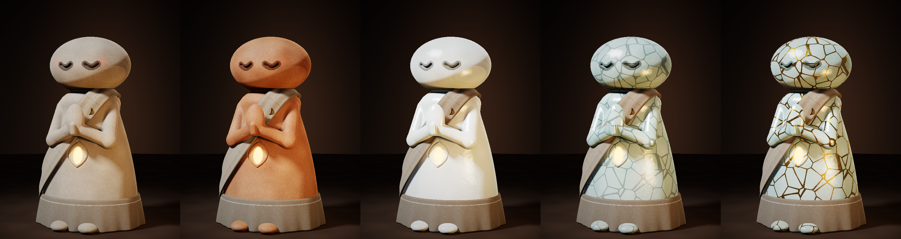

# 「云上寺」网上寺庙 · 全面开发设计规划

Nov 9, 2026 · @taotao

## 一、项目概述与定位

**结论：做一个「手机浏览器打开即进入、无需下载」的多人 3D 心灵空间，以“安静陪伴”为核心体验，以“多国礼俗道具 + 代理开庙”为增长与变现引擎。** 工作名暂定「云上寺」（海外名 Cloud Sanctuary）。

**参考案例拆解（视频中的韩国「山寺」）：** 一位不会写代码的 26 岁青年用 AI 做出网页版寺庙，用户化身 Q 版小和尚，在大殿里打坐、合掌、敲木鱼、拨念珠；每个房间 100 人上限，线上人数从 20 涨到上万，服务器一度被挤爆。它成功的原因只有三点：

1. **零门槛**：手机浏览器打开链接就进，不注册、不下载。
2. **“一起但不打扰”**：看得到别人在旁边静坐，但不能聊天，只能互相合掌致意——孤独感被化解，又没有社交压力。
3. **极简动作 + 真实声音**：四个按钮（合掌 / 拜 / 木鱼 / 念珠），每个都有高质量音效和触感反馈。

**它的短板，也是我们的机会：** 只有一种文化（韩国禅寺）、没有长期目标（玩几次就腻）、没有变现、服务器扛不住、无法让别人开分店。

**我们的定位：**

| 维度 | 韩国山寺 | 云上寺（我们） |  |
| --- | --- | --- | --- |
| 文化 | 韩国禅寺单一场景 | 中国佛道、日本神社寺院、韩国、泰国南传、藏传、西方冥想等多套场景 |  |
| 交互 | 4 个动作 | 动作 + 上香、烧纸、求签、绘马、许愿灯、放生、抄经等道具仪式 |  |
| 留存 | 无 | 修行等级、功德簿、每日一签、节气节日、长明灯订阅 |  |
| 供给 | 官方一座庙 | 官方主殿 + 代理/机构开设的分寺（SaaS 模板化） |  |
| 变现 | 无 | 道具内购、会员、庙主订阅与分成、品牌合作 |  |
| 架构 | 单服务器 | 分房间分片的实时服务器集群，自动扩容 |  |

**目标人群（按优先级）：**

- **压力型都市白领（22–40 岁）**：睡前 5–15 分钟“放空”，要安静、要好看、要不被打扰。核心付费人群。
- **有民俗需求的人**：考试、求职、生病、清明中元祭祖、亲人离世后的寄托。需求刚、愿付费、节日集中爆发。
- **海外华人 / 日韩文化爱好者**：回不了家乡的庙，想“云祭祖”“云参拜”。
- **寺院、道观、殡葬与文旅机构**：想要线上分身但没技术能力——这是代理开庙的 B 端客户。

**产品原则（所有设计都以此检验）：** 安静优先于热闹；尊重优先于搞笑；仪式感优先于功能堆叠；一分钟内完成第一次“上香”。

## 二、核心体验设计

**结论：一次完整参拜 = 进山门 → 选殿 → 行礼或静坐 → 祈愿道具 → 收到回应，控制在 3–15 分钟。** 三条主线并行：静修线（放空）、祈愿线（寄托）、同修线（陪伴）。

### 2.1 首次进入（前 60 秒决定留存）

1. 点开链接 → 黑屏淡入钟声 + 山门远景，3 秒内可见画面（先加载低模，后台流式加载高模）。
2. 一句引导：“戴上耳机，慢慢吸一口气。”——顺带解锁浏览器音频权限。
3. 自动分配一个温和的法名（如“清风居士”“小松叶”），游客身份即可玩，第一次保存功德时才引导登录。
4. 选择今天的心情（焦虑 / 疲惫 / 想念某人 / 有所求 / 只是看看）——直接决定推荐哪个殿、哪种仪式。
5. 第一个任务永远是“上一炷香”：长按点香 → 拖到香炉 → 烟缓缓升起，是整个产品最需要打磨的 30 秒。

### 2.2 三条主线

| 主线 | 用户动机 | 核心玩法 | 单次时长 | 变现点 |
| --- | --- | --- | --- | --- |
| 静修 | 放空、助眠、减压 | 打坐计时、呼吸引导、木鱼、念珠 108 颗、听经、抄经 | 5–30 分钟 | 会员（高品质念诵音频、空间音效、专属禅房） |
| 祈愿 | 有所求、想念、祭拜 | 上香、求签、绘马、烧纸、点灯、挂福牌、愿望墙 | 2–5 分钟 | 道具内购（主要收入） |
| 同修 | 不想一个人 | 同殿静坐、互相合掌致意、定时集体早晚课、节日法会 | 10–60 分钟 | 法会预约、庙主活动票 |

### 2.3 场景与空间

- **山门 / 参道**：加载与过渡区，可缓步行走，带季节变化（春樱、夏雨、秋枫、冬雪），天色跟随用户本地时间。
- **大殿（主展）**：最多 100 人一个房间，蒙布排布是实时同步的关键场景。
- **香炉广场**：所有人上的香都留在炉里，烟量随全服当日上香数增加——“香火旺”可视化。
- **禅房（单人）**：离线级安静，不显示其他人，用于深度冥想、睡前使用。
- **愿望墙 / 绘马架**：用户写下的愿望公开悬挂（可选匿名），他人可“随喜”（点赞的宗教化表达）。
- **祖先堂 / 往生堂**：给离世亲人设灵位，清明、中元、忌日提醒祭拜——情感粘性最强的模块。

### 2.4 社交边界（刻意克制）

- 大殿内**没有文字聊天**，只有预设致意：合掌、顶礼、随喜、“愿你安好”。从根本上杜绝骚扰和审核压力。
- 用户头顶只显示法名和修行等级徽记，不显示真实身份。
- 好友系统只用于“一起进殿”和“为对方点灯祈福”，不做私信。

## 三、多国习俗与道具体系

**结论：首发 3 套文化场景（中式佛道、日式神社寺院、韩式山寺），第二期加泰式、藏式与世俗冥想场景。** 每个道具都按同一套「四层反馈」制作，这是“真实感”的来源。

### 3.1 道具的四层反馈标准

1. **手势**：用真实动作映射。摇签筒 = 摇手机（陀螺仪）；点香 = 长按等火苗引燃；念珠 = 向下拨动；烧纸 = 一张张拖进火盆；转经筒 = 顺时针划动。
2. **视觉**：粒子烟雾、火星、纸灰飘散、烛光摇曳，全部用轻量 GPU 粒子，低端机自动降级。
3. **声音**：实地录制（寺院钟声、真实木鱼、签筒碰撞、纸燃烧的噼啪声），空间混响。声音是这类产品 50% 的体验。
4. **回应**：每次仪式必须有文字或画面上的“回音”——签文、祝福语、功德 +1、香炉烟变浓。没有回应的仪式会让人觉得空。

手机震动反馈仅 Android 浏览器支持；iOS Safari 的陀螺仪需用户点击授权，并无震动接口，需要做按钮替代方案。

### 3.2 道具与仪式总表

| 场景 | 道具 / 仪式 | 交互方式 | 回应 | 定价建议 |
| --- | --- | --- | --- | --- |
| 中式佛寺 | 上香（清香 / 高香 / 龙凤香） | 长按点燃、拖入香炉、三拜 | 香炉烟量 + 功德 | 清香每日 3 炷免费；高香 ¥1–6 |
| 中式佛寺 | 求签（观音灵签 100 签） | 摇手机摇签筒 → 掉签 → 掷筊确认 | 签文 + 白话解签 | 每日 1 签免费；AI 详解 ¥3 |
| 中式佛寺 | 点灯（长明灯 / 光明灯 / 药师灯） | 写名字 → 点亮供于灯墙 | 灯墙上可见自己的灯 | 按月订阅 ¥6–30 |
| 中式佛寺 | 木鱼 / 念珠 / 抄经（心经） | 点击、拨珠、屏幕描红 | 计数与合计功德 | 免费；精品木鱼皮肤 ¥6–18 |
| 中式道观 | 拜太岁 / 安太岁 | 按生辰自动判断是否犯太岁 | 年度平安牌 | 年度 ¥30–88 |
| 中式道观 | 文昌（考试）、财神（求财）、月老（姻缘） | 上香 + 挂祈愿牌；月老可绑红线 | 愿牌悬挂可见 | ¥3–18 |
| 中式祭祖 | 烧纸（金元宝、纸钱、纸扎房车） | 拖纸入火盆，燃烧粒子 + 纸灰上飘 | 祖先堂“已收到” | 基础免费；纸扎 ¥1–12 |
| 中式祭祖 | 灵位 / 献花 / 供果 / 留言 | 上传照片建灵位，忌日提醒 | 家人共享的纪念页 | 灵位永久 ¥68–198 |
| 日式神社 | 手水舍净手 → 摇铃 → 投赛钱 → 二礼二拍手一礼 | 按顺序完成动作，拍手可用麦克风识别 | 参拜完成动画 | 免费（引流） |
| 日式神社 | 御神签（大吉–凶） | 抽签；凶签可系在签挂上“留下厄运” | 签文 + 各项运势 | 每日 1 次免费 |
| 日式神社 | 绘马 / 御守 | 绘马上手写愿望；御守分健康、学业、恋爱 | 悬挂于绘马架 / 个人页显示 | ¥3–18 |
| 日式寺院 | 御朱印帐 | 每座庙、每个节日参拜后盖一枚独特印章 | 收集册 | 核心留存道具，限定印可付费 |
| 韩式山寺 | 108 拜 / 合掌 / 木鱼 | 自动播放节拍跟拜 | 拜数计数 | 免费 |
| 韩式山寺 | 蒲公瓦祈愿 / 燃灯（莲花灯） | 在瓦片上写字，用于“修缮大殿” | 大殿屋顶真的可见 | ¥3–12 |
| 泰式（二期） | 献茉莉花环、贴金箔、洒水祝福 | 拖动金箔贴在佛像上 | 佛像随全服累积变金 | ¥1–6 |
| 藏式（二期） | 转经筒、挂经幡、酥油灯 | 顺时针划动转经；经幡随风飘动 | 转经数计数 | 免费；经幡 ¥3–6 |
| 世俗冥想（二期） | 许愿池投币、许愿蜡烛、散文字记录 | 弹币入水、点蜡烛 | 水波纹 + 蜡烛墙 | ¥1–6 |

### 3.3 玄学系统（个性化引擎）

用户可选填生日（公历/农历）。填了之后，整座庙对他“有反应”：

- **本命佛**：按生肖对应八大守护神（如属鼠对千手观音、属兔对文殊菩萨），个人首页供奉自己的本命佛。
- **每日黄历**：宜忌、吉时、财神方位、幸运色；推送文案如“今日宜祈福，吉时未时”。
- **流年太岁**：按当年干支自动算出哪些生肖犯太岁，年初精准推送“安太岁”。
- **二十四节气 + 佛诞等节日**：场景换装、限定御朱印、限定道具。
- **AI 解签**：签文用传统公版文本（观音灵签、关帝灵签），结合用户所问事项生成白话解读。语气定为“善意提醒 + 可行动的建议”，禁止恐吓式文案与“花钱消灾”引导（见第八章）。

## 四、可玩性与留存粘性系统

**结论：粘性靠三件事——每天有一个“理由回来”（日签 + 黄历），长期有一个“积累可见”（功德与御朱印），情感上有一个“牽挂”（灵位、长明灯、为他人祈福）。** 不做排行榜和战力比拼，那会破坏“放空”的气氛。

### 4.1 日 / 周 / 长期三层循环

| 周期 | 触发 | 用户做什么 | 留存钩子 |
| --- | --- | --- | --- |
| 每天 | 早 8 点黄历推送 / 晚 10 点“晚课”提醒 | 日签、免费 3 炷清香、睡前静坐 | 连续参拜天数（断签可用“补课”恢复，不惩罚） |
| 每周 | 初一十五、周日集体法会 | 在固定时间和全服一起念诵 | “同修”的仪式感，拥挤度可见 |
| 每月 | 长明灯续灯、月度御朱印 | 续订、收集新印 | 灯灭了会心疼 |
| 节日 | 春节、元宵、清明、佛诞、中元、除夕、日本初诣、韩国燃灯会 | 限定场景、限定道具、除夕零点敲钟 108 下 | 全年流量高峰与收入高峰 |
| 长期 | 生日、亲人忌日、感悟日（注册纪念日） | 祭拜、祈福、回顾一年的愿望 | “你去年的愿望实现了吗？”还愿功能 |

### 4.2 修行与功德（成长线）

- **功德值**：所有善行累加（静坐分钟、拜数、抄经字数、为他人祈福、随喜他人愿望）。**付费道具不增加功德**——功德买不到，这是口碑和合规的关键。
- **修行阶位**（按累计修行时长）：初来居士 → 常住居士 → 护法 → 小沙弥 → 禅子。每阶解锁寺内可见的变化：服饰颜色、蒲团、坐在更前的位置。
- **御朱印帐**：每座庙、每个节气、每场法会各一枚。代理开的分寺也有独家印——这会把官方用户导向代理寺院，反之亦然，形成网络效应。
- **愿望日记**：所有祈愿、签文自动归档，形成个人的“心路历程”，年底生成可分享的年度回顾长图。

### 4.3 自传播设计

- **为他人点灯 / 祈福**：生成一张精美的祈福卡链接，对方点开就看到“有人在云上寺为你点了一盏灯”，并直接进入场景——这是最重要的拉新链路。
- **签文分享图**：竖版、古风、适合朋友圈 / 小红书 / Instagram Story。
- **一键组队进殿**：家人一起云祭祖、情侣一起拜月老。
- **实时人数**：首页显示“此刻有 3,218 人和你一起静坐”，制造陪伴感和社会认同。

## 五、代理开庙 SaaS 体系

**结论：代理开庙 = “选模板 + 换皮肤 + 配道具 + 定价格”，不写一行代码，48 小时内审核上线。** 平台提供场景、服务器、支付与审核，庙主负责内容和自己的信众流量，按道具流水分成。

### 5.1 庙主类型

| 类型 | 他们要什么 | 身份标识 | 定价层级 |
| --- | --- | --- | --- |
| 真实寺院 / 道观 / 神社 | 线上分身，接待远方信众，点灯供奉收入 | “官方认证”金标（需审核登记证明） | 旗舰版 / 定制版 |
| 陵园、殡葬机构 | 云祭扫、纪念馆，提升客户服务 | “机构认证” | 旗舰版 |
| 文旅景区、博物馆 | 数字导览、引流到线下 | “机构认证” | 标准版 / 定制版 |
| 冥想导师、疗愈工作室、文化博主 | 线上共修空间，粉丝变现 | “文化空间”（不得自称寺院） | 入门版 / 标准版 |
| 家族 / 同乡会 | 家族祖祠、族谱、家祭 | 私密（仅邀请可进） | 入门版 |

### 5.2 庙主后台功能

1. **开庙向导**：选场景模板（中式大雄宝殿、山间小庙、日式神社、韩式山寺、祖祠、纪念馆…）→ 选主供神像 → 上传匾额、楼联、封面文字 → 选季节天气 → 预览发布。
2. **空间编辑器**（标准版以上）：在预设槽位里摆放香炉、灯墙、绘马架、石灯、树木。用槽位而非自由摆放，保证画面质量和性能不崩。
3. **道具与定价**：从平台道具库勾选上架，在平台给定的价格区间内自定价（防止天价供奉）。旗舰版可上传自有独家道具（如本寺特色御守），需平台审核。
4. **活动与法会**：发布定时共修、直播讲经（音频或视频接入大殿的大屏）、报名与提醒。
5. **信众管理**：本寺关注者、长明灯到期提醒、功德榜（可关闭）、群发公告。
6. **数据看板**：访客、在线峰值、道具收入、热门道具、留存曲线。
7. **结算中心**：T+7 结算，对公 / 对私提现，发票与账单。
8. **自有域名与二维码**：旗舰版可绑定自己的域名，寺门口贴一个二维码即可引流。

### 5.3 庙主套餐与分成

| 套餐 | 年费 | 房间容量 | 道具分成（庙主 : 平台） | 主要能力 |
| --- | --- | --- | --- | --- |
| 入门版 | ¥0（免费开庙） | 1 殿，单房间 50 人 | 50 : 50 | 3 个基础模板，平台道具库 |
| 标准版 | ¥2,980 | 3 殿，自动扩容 | 70 : 30 | 全部模板、空间编辑器、活动与数据 |
| 旗舰版 | ¥19,800 | 不限，独立服务器池 | 80 : 20 | 自有域名、独家道具、直播、认证标 |
| 定制版 | ¥80,000 起（一次性） | 按需 | 按合同 | 按真实寺院 1:1 建模（实景扫描） |

以上价格是推算的起步建议，需在内测期用 10–20 家种子庙主验证。应用商店内支付另有 15–30% 通道费，故以 H5 + 网页支付为主。

### 5.4 审核与治理

- **开庙审核**：实名 + 主体资质；自称“寺院 / 道观”必须提供宗教活动场所登记证，否则只能以“文化空间 / 冥想空间”名义开设。
- **内容审核**：匾额、公告、自有道具走机审 + 人审；禁止“付费消灾、保证灵验、不供奉就有灾”类恐吓性营销。
- **退出与数据可携**：庙主停续后，用户已点的灯和灵位迁至官方主寺继续保留——用户的寄托不能因庙主关门而消失。

## 六、技术架构

**结论：Web 3D（Three.js）+ 房间制权威实时服务器（Colyseus）+ 多租户业务后端，全部容器化自动扩容。** 寺庙节奏慢，状态同步只需每秒 10 次，单人带宽约 1–2 KB/s，万人同时在线的服务器成本很低；真正的难点在手机端 3D 性能和首屏加载。

### 6.1 技术选型

| 层 | 选型 | 理由 |
| --- | --- | --- |
| 3D 渲染 | Three.js + React Three Fiber，TypeScript；WebGL2 为主，WebGPU 为增强 | 生态最大、招人容易，微信内置浏览器兼容好 |
| 美术资产 | glTF + Draco / Meshopt 压缩，KTX2 纹理，烘焙光照，3 级 LOD | 首屏 ≤ 3 MB，全场景 ≤ 25 MB，中端机 60 fps |
| 音频 | Web Audio API，空间化音效，环境音分层混音 | 声音是沉浸感主来源 |
| 实时联网 | Colyseus（Node.js），WebSocket，房间制，每房间 100 人，10 Hz 增量同步 | 开源、自带房间与匹配、状态增量同步开箱即用 |
| 业务后端 | NestJS（或 Go）服务：账号、支付、道具与背包、寺庙租户、签文内容、通知、审核 | 与实时服务器同语言，小团队维护成本低 |
| 数据 | PostgreSQL（主数据，按 temple\_id 多租户）、Redis（在线状态、全服香火计数、跨进程房间发现）、ClickHouse（行为分析） | 成熟稳定 |
| 资源分发 | 对象存储 + CDN，庙主皮肤按租户配置运行时加载 | 一套代码支持无限座庙 |
| AI | 大模型 API（解签、祈愿回应、内容审核），结果缓存 | 100 签 × 常见事项可预生成，大幅降成本 |
| 部署 | Docker + Kubernetes，实时服按房间数自动扩容 | 爆红时不会像韩国山寺一样被挤崩 |

### 6.2 实时同步设计

- **同步什么**：每个化身的座位或位置、朝向、当前动作（静坐 / 合掌 / 拜 / 行走）、法名与徽记。动作是广播事件，客户端自己播动画。
- **不同步什么**：烟雾、烛光、粒子全由客户端生成；他人的道具只同步“某人上了一炷高香”这一事件。
- **万人在线**：同一座殿按 100 人分房间（分线），用户无感；“全寺当前 3,218 人”“今日香火 52,031 炷”由 Redis 聚合后每 5 秒广播。
- **殿内满员的视觉**：少于 30 人的房间用“影子同修”（半透明、标注为“此前来过的人”）补位，不假装是真人。
- **防作弊**：功德、拜数、静坐时长在服务端计算并限速；支付回调幂等，道具发放以服务端为准。

### 6.3 性能预算（硬指标）

| 指标 | 目标 |
| --- | --- |
| 首屏可见（4G） | ≤ 3 秒 |
| 大殿三角面数 | ≤ 30 万（含 100 个化身，化身用 GPU Instancing） |
| Draw Calls | ≤ 150 |
| 帧率 | 中端机 60 fps，低端机自动降级保 30 fps |
| 单用户下行带宽 | ≤ 2 KB/s |
| 单实时进程承载 | 约 2,000 人（压测确认） |

### 6.4 地域部署

中国大陆与海外两套独立部署，数据不互通：大陆用阿里云或腾讯云（需 ICP 备案，支付接微信 / 支付宝，可叠加微信小程序版）；海外用 AWS 或 GCP + Cloudflare（支付接 Stripe，日本加 PayPay，韩国加 KakaoPay）。两端共用一套代码和美术资产。

> 📊 图：云上寺整体架构（客户端、接入、服务、数据四层）——见在线文档 https://claude.ai/artifact/SUG1uj71RSVjmgsHgkP9mz ，代码实现见 `docs/ARCHITECTURE.md`

任何客户端都只经过三个入口；重点标出的实时房间服务是“同殿共修”的核心，也是爆红时需要水平扩容的部分。

### 6.5 场景扩展底座（为后续大陆景点预留）

**结论：场景从第一天起就做成“后台上传、自动处理、在线预览、按地区上架”的数据，而不是写死在代码里。** 以后加大陆各大景点，只需在后台上传和配置，不改代码、不发版。这套底座在 P1 做完，约增加 2–3 周工作量。

| 底座模块 | 现在要做到 | 以后接大陆景点时 |
| --- | --- | --- |
| 场景包格式 | 统一的 Scene Package：glTF 模型 + 行走与碰撞网格 + 槽位表（香炉、灯墙、座位、拍照点）+ 环境（天空、季节、音效）+ manifest.json | 新景点按同一格式交付即可 |
| 后台上传与自动处理 | 上传后自动压缩（Draco / KTX2）、生成 3 级 LOD、烘焙光照、生成缩略图；面数或贴图超出 6.3 的预算则拒收并提示 | 外包或扫描团队直接上传 |
| 后台 3D 预览器 | 与前台同一套渲染器，可在后台看到最终效果、拖动调整槽位、切换季节与昼夜后一键发布 | 运营人员自己上新，不用工程师 |
| 实景渲染图层 | 渲染器预留 3D 高斯泼溅（Gaussian Splatting）图层，可与 glTF 混合：远景用实景扫描，近景可交互道具用模型 | 真实景点用手机或无人机扫描生成，成本远低于手工建模 |
| 场景注册表 | scene\_id、名称、地理坐标、文化类型、地区上架开关（台湾 / 海外 / 大陆）、授权状态、合规模式 | 大陆景点默认只在大陆区上架 |
| 合规模式开关 | 每个场景可设“宗教仪式模式”或“文化游览模式”；后者自动隐藏上香、念诵等仪式，只保留导览、冥想、祈福灯、祭扫 | 满足 8.1 的大陆要求 |
| 寺庙地图入口 | 首页预留“寺庙地图”，按地区浏览 | 大陆景点上线后自动出现在地图上 |
| 授权与合作字段 | 景区 / 寺院授权书上传、到期提醒、分成方 | 用真实景点名称与外观前必须有授权（见 8.2） |
| 实时服务与场景解耦 | 房间服务只认 scene\_id 与槽位表，不关心模型长什么样 | 加场景不用改服务器 |
| 大陆部署接口 | 配置、支付、资源域名全部按地区参数化（见 6.4） | 大陆上线只是新开一套环境，不重写 |

## 七、商业模式与定价

**结论：“参拜永久免费，付费只买仪式感和沉浸度，不卖灵验。”** 六条收入线按阶段打开：先道具内购，再会员、祭祖与庙主 SaaS，最后实物与品牌合作。

| 收入线 | 内容 | 价格区间 | 上线阶段 |
| --- | --- | --- | --- |
| 道具内购 | 高香、点灯、纸扎、绘马、御守、AI 详解签、限定御朱印 | ¥1–30 / 次，点灯按月 | MVP |
| 会员「常住」 | 每日高香、全部念诵与助眠音频、专属禅房、无限 AI 解签、年度回顾 | ¥18 / 月，¥168 / 年 | V1 |
| 庙主 SaaS | 年费 + 道具分成（见 5.3） | ¥0–19,800 / 年，定制 ¥80,000 起 | V1 内测，V2 开放 |
| 纪念 / 祭祖 | 永久灵位、家族祖祠、纪念馆空间 | ¥68–598 一次性 | V1 |
| 实物联动 | 线上求得的御守 / 签文卡 / 手串寄实物（与真实寺院合作开光制作） | ¥39–199 | V2 |
| 品牌合作 | 节日场景冠名、文旅局、香薰 / 茶 / 助眠类品牌 | 按项目 | V2 |

**单位经济推算（待内测数据校正）：** 若付费率 4%、付费用户月均消费 ¥30，则每 10 万月活月收入约 ¥12 万；节日月（春节、清明、中元）通常是平时的 3–5 倍。服务器成本在此规模下每月约 ¥1–3 万，主要支出是 CDN 流量和 AI 调用。

**定价红线：** 不卖“消灾”“改命”；不设「功德充值」；签文好坏与是否付费无关；不做抽卡开箱；未成年人单日消费上限。

## 八、合规、宗教尊重与风险控制

**结论：首发市场已定为台湾与海外华人（含港澳、新马、日韩华人），大陆各大景点场景后续经 6.5 的场景底座在后台接入，大陆版须重新定位并做法律评估后再进入。** 原因是大陆《互联网宗教信息服务管理办法》（2022 年 3 月 1 日施行）对这类产品有直接限制。以下是产品层面的风险梳理，不是法律意见，上线前请各市场本地律师确认。

### 8.1 中国大陆的硬性限制

- 向公众提供宗教教义、知识、文化、活动等信息，需取得互联网宗教信息服务许可（第六条）。
- 任何组织或个人不得以文字、图片、音视频方式直播或录播拜佛、烧香、诵经等宗教仪式（第十七条）。
- 任何组织或个人不得在互联网上设立宗教活动场所、发展教徒（第十八条）——“网上寺庙”和“代理开庙”正好撞在这一条上。
- 不得以宗教名义进行商业宣传、经销宗教用品（第十四条第九项）——影响道具付费与实物御守。

**大陆版可行路径：** 定位改为“东方文化冥想 + 民俗祈福 + 网络祭扫”空间，去掉佛像礼拜与念诵等宗教仪式，只保留冥想、祖先祭扫、节气民俗、许愿灯；不对外开放个人“开庙”，只与持证宗教场所或殡葬、文旅机构合作。网络祭扫方向相对安全，可作为大陆切入点。

### 8.2 各市场通用合规项

| 项目 | 要求 | 处理方式 |
| --- | --- | --- |
| 个人资料 | 台湾个资法、日本 APPI、韩国 PIPA、欧盟 GDPR | 生辰、宗教倾向属敏感资料：选填、单独同意、可一键删除 |
| 虚拟商品 | 消费者保护、退款、订阅自动续费提醒 | 明示价格与效力“仅为线上心意表达” |
| 未成年人 | 各地游戏 / 虚拟消费规定 | 年龄门槛、单日消费上限 |
| 内容审核 | 愿望墙、绘马、庙主公告为 UGC | 机审 + 人审，默认匿名、可举报 |
| 知识产权 | 真实寺院名称、商标、博物馆藏品扫描 | 不擅用真实庙名（如灵隐寺、浅草寺），神像自建模；签文用公版古文或自写 |
| 代收代付 | 庙主分成涉及支付牌照 | 接入持牌分账服务（如 Stripe Connect），平台不代管资金 |

### 8.3 宗教尊重准则

- 每种文化聘请至少一位顾问（法师、道长、神职或民俗学者）审核仪轨与签文，顾问名单公开。
- 不做佛像 / 神像的搞笑皮肤。化身不能站上供桌、不能背对主供躺下。不同宗教的神像不混放在同一殿。
- 首发不含一神教（基督教、伊斯兰教等）场景，西方场景用世俗的许愿池与烛光冥想。
- 产品内始终说明：线上参拜是心意与陪伴，不替代线下修行，也不承诺任何灵验。

### 8.4 用户心理安全

来这里的人不少正处在低谷（亲人离世、重病、失意）。愿望与祈福文字若出现自伤或轻生念头，系统会在回应中温和地附上当地心理援助热线；AI 解签不得给出医疗、投资、法律上的确定性建议，也不得以“凶签”制造恐慌。

法规依据：[《互联网宗教信息服务管理办法》全文（中国网信网）](https://www.cac.gov.cn/2021-12/20/c_1641594960049078.htm)

## 九、团队配置、开发排期与预算

**结论：用 6 周做出可联网的单殿原型验证留存，再用 10 周做 MVP，赶在 2027 年 4 月 5 日清明节前公开上线——清明是云祭扫的全年最大流量窗口。** 预算以人民币估算，需按实际用人地区调整。

### 9.1 两种启动方式

| 方式 | 人员 | 做法 | 产出 | 预算（至 MVP） |
| --- | --- | --- | --- | --- |
| 精益版（推荐先走） | 2–3 人：1 全栈工程师 + 1 3D 美术 + 兼职产品 | AI 编程助手写代码，购买商用 3D 素材再改，音效外包 | 单场景、上香 / 求签 / 静坐、100 人联网 | ¥30–60 万 |
| 标准版 | 9–10 人（见下表） | 自研美术与引擎封装，可支撑 SaaS | 三套场景、支付、祖先堂、庙主后台雏形 | ¥150–200 万 |

建议先用精益版做原型，用真实数据（次日留存、上香付费转化）去招人或融资，再扩成标准版。

### 9.2 标准版团队

| 角色 | 人数 | 关键能力 |
| --- | --- | --- |
| 制作人 / 产品负责人 | 1 | 懂游戏系统设计与付费设计，尊重宗教文化 |
| 3D 前端工程师 | 2 | Three.js / R3F、性能优化、粒子与着色器 |
| 后端 / 实时工程师 | 2 | Colyseus、支付、多租户、K8s |
| 3D 美术（场景 + 角色） | 2 | 东亚建筑与神像建模、烘焙、低模 |
| 技术美术 | 1 | 资产管线、LOD、烟火特效 |
| UI / 交互设计 | 1 | 简洁安静的东方美学，参考韩国山寺的毛玻璃风格 |
| 测试 + 运营 | 1–2 | 多机型测试、社群、节日活动 |
| 外包 | — | 寺院实地音效录制、念诵配音、文化顾问、法律 |

### 9.3 阶段交付物

| 阶段 | 时间 | 交付 | 过关标准 |
| --- | --- | --- | --- |
| P0 原型 | 2026-11-23 → 2027-01-03（6 周） | 中式大殿一座；上香、求签、木鱼、念珠、静坐；100 人同殿 | 200 位种子用户次日留存 ≥ 35% |
| P1 MVP | 2027-01-04 → 2027-03-14（10 周） | 日式 / 韩式场景、账号与支付、祖先堂、烧纸、点灯、黄历、每日签 | 压测 10,000 人同时在线不掉线 |
| 公开上线 | 2027-03-15 → 2027-04-05 | 清明云祭扫活动 | 付费率 ≥ 3% |
| P2 V1 | 2027-04-06 → 2027-06-27（12 周） | 会员、御朱印、祈福卡裂变、庙主后台内测 10–20 家 | 种子庙主续约意向 ≥ 60% |
| P3 V2 | 2027-06-28 → 2027-09-30 | SaaS 公开招商、泰式与藏式场景、实物联动、品牌合作 | 庙主收入占比 ≥ 25% |

### 9.4 标准版十个月预算（P0 至 P3）

| 项目 | 估算 |
| --- | --- |
| 人力（10 人 × 月均 ¥2.5 万 × 10 个月） | ¥250 万 |
| 美术素材、音效录制、配音外包 | ¥40–60 万 |
| 服务器、CDN、AI 调用 | ¥15–30 万 |
| 法律、商标、文化顾问 | ¥10–20 万 |
| 上线与节日推广 | ¥50–100 万 |
| **合计** | **¥365–460 万** |

> 📊 图：开发排期（四个阶段与清明上线节点）——见在线文档，文字版见 `docs/ROADMAP.md`

清明（2027-04-05）是唯一不能顺延的节点；P0 留存未达标时，宁可缩减 MVP 的场景数，也要保住祖先堂与烧纸功能按时上线。

## 十、关键指标与上线运营策略

**结论：北极星指标定为“每周完成至少一次完整参拜的人数”，而不是收入或在线人数。** 它同时反映留存和价值，也能防止团队为了短期收入而破坏氛围。

### 10.1 指标体系

| 指标 | 定义 | 上线 3 个月目标 |
| --- | --- | --- |
| 周参拜用户（北极星） | 每周至少完成 1 次“进殿 + 一项仪式” | 3 万 |
| 首次上香完成率 | 进入后 60 秒内完成上香 | ≥ 70% |
| 次日 / 7 日留存 | 标准定义 | ≥ 35% / ≥ 18% |
| 人均单次时长 | 单次会话 | 6–12 分钟（过长反而不健康） |
| 付费率 | 月付费人数 / 月活 | ≥ 3%（节日月 ≥ 6%） |
| 祈福卡拉新率 | 每张分享卡带来的新用户 | ≥ 0.3 |
| 庙主续约率 | 到期续费庙主占比 | ≥ 60% |

### 10.2 冷启动打法

1. **短视频内容先行**：韩国山寺是靠一条视频爆的。开发期就持续发“我在做一座网上寺庙”的开发日记，积累预约名单。
2. **种子社群**：从冥想、失眠、考研、离乡游子等社群招 200 位内测用户，每周收集反馈。
3. **节日引爆**：清明云祭扫（首发）、佛诞纳浴佛、中元点河灯、除夕 108 响钟声——每个节日提前 3 周做内容预热。
4. **台湾宫庙文化切入**：安太岁、点光明灶、文昌帝君、妈祖在台湾普及度极高，且没有大陆的宗教线上限制，适合作为第一个付费市场。
5. **庙主即渠道**：每签一家真实寺院或陵园，就在其线下场所贴二维码，把它的信众带到线上。

### 10.3 下一步（本周可开始）

- [x] 确定首发市场（台湾 / 海外华人 / 大陆文化版）并向律师咨询
- [x] 选择精益版或标准版启动
- [x] 注册品牌名与域名、商标检索
- [x] 用 2 周做出“上一炷香”的单点体验 Demo，先给 20 个人试
- [x] 联系 3–5 家意向庙主（寺院、陵园、冥想工作室）做需求访谈

## 十一、美术与渲染：写实场景与人物设计

**结论：场景走“近照片级写实”，人物走“风格化写意”。** 网页端要在手机上同时显示 100 个人，全写实人物会卡顿，也容易显得僵硬（恐怖谷）。真实的山、殿、光、烟配上安静、简洁的人物，沉浸感更强，用户也更愿意把自己代入进去。

### 11.1 写实场景渲染方案

| 技术 | 做法 | 效果 |
| --- | --- | --- |
| 实景扫描（3D 高斯泼溅） | 山门、参道、远山、古树用无人机 + 相机实拍生成；只用于不可交互的远景和中景 | 接近照片的真实质感，成本远低于手工建模 |
| PBR 材质 + 烘焙光照 | 大殿、供桌、香炉等可交互物件用精模；光照在 Blender 或 Unreal 中离线烘焙 | 木纹、金箔、石材、铜炉的光泽真实，运行时几乎不耗性能 |
| 昼夜与天气 | 晨、昼、黄昏、夜四套烘焙光照平滑过渡；雨天地面湿润反光、雾气、雪地 | 跟随用户本地时间，深夜进殿就是烛光与月光 |
| 光与气氛 | 体积光束（光从殿门斜射进来）、空气尘埃、烛火微微摇曳的动态点光源 | “寺庙感”主要来自光与烟 |
| 烟与火 | 香烟用序列帧粒子 + 风场扰动；烧纸用火星、卷曲纸面、灰烬上飘 | 上香后烟会被风吹歪、绕过佛像 |
| 植物与水 | 树叶、竹林、经幡用风动着色器；放生池水面反射与锦鲤 | 画面“会呼吸”，静坐时不死板 |
| 后期处理 | 轻度泛光、环境光遮蔽、景深、电影色调曲线 | 统一温暖、沉静的色调 |

**画质分级（进入时自动测试设备）：** 高画质用 WebGPU，全部特效 + 完整实景扫描；中画质关闭景深与动态阴影；低画质用烘焙全景图替代远景、粒子减半。面数与帧率仍以 6.3 的硬指标为准。

**应该有的预期：** 手机浏览器做不到主机游戏那种全实时的光线追踪，但“实景扫描 + 烘焙光照 + 好的烟和光”的组合，在静态寺庙场景上可以做到接近照片的效果。寺庙大部分东西不动，这正好是这套方案最擅长的。

### 11.2 人物设计：六套化身

| 套装 | 风格 | 外观设定 | 适合场景 | 获取方式 |
| --- | --- | --- | --- | --- |
| A · 小沙弥 / 小居士 | Q 版，3 头身 | 圆头大脸、眼睛微闭带笑；光头或小发髻两种头型；灰白羁衣斜披素色羈裈，布鞋 | 所有场景（默认） | 免费 |
| B · 素衣居士 | 写意，6.5 头身 | 成年比例、五官简化不描细；汉式交领素色居士服（米白、茶褐、黛蓝），腰系绳结，可配手串 | 中式佛寺、道观、祖先堂 | 免费，配色会员解锁 |
| C · 和风参拜客 | 写意，6.5 头身 | 浴衣或羽织 + 袚，木屐；女性可选编发；花纹按季节变化（春樱、夏朝颜、秋枫、冬梅） | 日式神社寺院 | 季节花纹限定付费 |
| D · 韩式修行者 | 写意，6.5 头身 | 灰色生活韩服式修行服，宽松绑腿，可配百八念珠 | 韩式山寺 | 免费 |
| E · 光影身 | 抽象写意 | 无五官的半透明人形，内部有缓慢流动的暖光；静坐越久光越亮；也用作 6.2 的“影子同修” | 禅房、祖先堂、深夜静修 | 修行阶位达到“护法”解锁 |
| F · 华谊心愿服 | 写意，6.5 头身 | 西式简约立领长衫或卸色西装，给不想穿古服的人一个“普通人来上香”的选择 | 所有场景，供海外用户 | 免费 |

**各套共通的自定义项：** 肤色 6 档；发型（光头、短发、束发、长发）；服色随 4.2 的修行阶位变化（初来灰白 → 禅子茶褐金边）；配饰（念珠、御守、香囊、斗笠、油纸伞）。不提供表情夸张的动作，保持安静。

**随行灵兽（收集类道具）：** 稻荷小狐、奈良小鹿、锦鲤、白鹤、寺猫。它们跟在化身旁边、在你静坐时趴下睡觉，是很好的留存与付费点。

**NPC 引导人：** 每座庙一位。中式为知客小师父，日式为神社的引导神职，韩式为山寺的小师父。只负责引导仪轨、解释道具怎么用，不讲经、不替用户做宗教判断。

### 11.3 人物技术规格

| 项目 | 标准 |
| --- | --- |
| 面数 | Q 版约 3,000 三角面，写意版约 6,000；各有 2 级 LOD |
| 骨骼 | 所有人形套装共用一套骨架，Q 版用重定向，动作只做一遍 |
| 贴图 | 每套一张 1024 图集，换色用颜色遮罩，不增加贴图 |
| 渲染 | 同套装用 GPU Instancing 批量绘制；布料轻度物理只给自己的化身 |
| 动作清单 | 站立呼吸、行走、合掌、问讯（合掌小鹞躬）、五体投地拜、跪坐、盘腿打坐、上香三拜、摇签筒、敲木鱼、拨念珠、二礼二拍手一礼、点灯、招手致意，共 14 个 |

**对预算的影响：** 标准版团队建议增加 1 位角色美术（含绑定与动作）；实景扫描每座场景约需 ¥3–8 万外包（拍摄 + 处理），另加场地授权。这两项都是估算，需向外包方询价确认。

### 11.4 招牌原创人物：「泥生」

**结论：用户的化身是一尊会动的小陶俑——「泥生」，取“莲从泥中生”之意。** 它的釉色会随你的修行记录“烧”出来，所以世界上没有两尊一样的泥生。它可作为 11.2 六套化身之外的招牌套装，也可以直接取代套装 A 成为默认化身。

**为什么是陶土：**

- **跨文化**：中国宋瓷、日本乐烧、韩国高丽青瓷都是各自最骄傲的工艺，一个形象能同时站在三套场景里。
- **和写实场景不冲突**：陶土是真实材质，PBR 渲染出来就是一尊真实的陶俑，在照片级的大殿里不会像卡通贴纸。
- **没有恐怖谷**：本来就是小陶俑，简化的脸是合理的。
- **自带叙事**：素坯→烧制→施釉→窑变→金缮，就是一条现成的修行成长线。

#### 外形设定

| 部位 | 设定 | 设计理由 |
| --- | --- | --- |
| 比例 | 4 头身，圆润宽底，重心低 | 看起来稳、沉、有分量，坐下时像一个小钟 |
| 脸 | 无嘴；眼睛是两道指尖压出的弯弧，永远微闭带笑 | 不说话、不夸张，符合“静”的气质；只在点灯的瞬间睁开 |
| 手 | 半包指手形：拇指、食指独立，其余三指合为一 | 合掌、拨珠、拿香三个动作都能看清楚 |
| 心灯 | 胸口一个小小的镂空，里面有一点暖光 | 静坐越久越亮；不用聊天，别人也看得见你在认真修行 |
| 背后指纹 | 背上留有一枚“制作时的指纹”，按用户 ID 生成 | 每尊泥生都独一无二 |
| 底座窑印 | 脚底刻有法名首字与“入寺日” | 五体投地时脚底朝上，旁人会看到，是很小的惊喜 |
| 服饰 | 真布料材质套在陶身上：中式羁衣、日式羽织、韩式修行服 | 硬的陶配软的布，材质对比很高级 |
| 声音 | 脚步是轻轻的“哚”；合掌是陶碰陶的清脆一声；坐下有极轻的瓷鸣 | 招牌音效，闭眼也能认出是云上寺 |

#### 修行即烧制：五个阶段

1. **素坯**（初来居士）：未烧的灰褐湿泥，表面留有指痕，哑光。
2. **素烧**（常住居士）：烧成温暖的赭红色，按压的指痕变得清晰。
3. **施釉**（护法）：第一层釉，默认青白。
4. **窑变**（小沙弥）：釉色由你的修行习惯决定——静坐多偏天青、上香多偏暖赭、抄经多会生出墨色冰裂纹、深夜静修多会出现兔毫般的银丝。不同人不会重样。
5. **金缮**（禅子）：见下方。

**金缮：“回来就好”。** 用户很久没来，泥生身上会出现发丝般的细裂纹，不影响任何功能。回来参拜一次，裂纹就被金线修补。所以越是离开又回来过的人，金线越多、越好看。这把“断签惩罚”变成了“归来奖励”，也契合金缮工艺本身接纳不完美的美学。

#### 动作细节（动画师的制作规范）

**三条总原则：** ① 陶是重的：动作要有下沉和落定，落地只有 2–3% 的轻微压缩，绝不弹跳。② 起身比下拜慢：恢复动作比下去慢约 30%，这就是“殊重”的感觉。③ 布料和心灯做跟随：衣袖慢主动作 2–3 帧，心灯在每个动作的关键帧轻轻亮一下。

| 动作 | 关键细节 | 时长 |
| --- | --- | --- |
| 待机呼吸 | 肩部随呼吸起伏 1–2%，吸气时心灯微亮；呼吸从每分钟约 12 次逐渐慢到 6 次；钟声响时会微微侧头，烟飘过时会抬眼追看；站着不动 30 秒后会自己坐下 | 4.5 秒 / 周期 |
| 行走 | 小步、微微左右摇摆，脚跟先着地；在参道石板上踏起极淡的尘，雨后地面有倒影；上台阶用 IK 让脚踩实每一级 | 每步 0.6 秒 |
| 合掌 | 双手从体侧划弧上提，指尖先碰、掌心后合（真实合掌的顺序），碰合瞬间发出“哚”声并停留 2 帧；头微低 15 度 | 1.2 秒 |
| 问讯（合掌鹞躬） | 合掌后从腰部前倾约 30 度，眼不睁开；起身比下倾慢 | 2 秒 |
| 五体投地拜 | 合掌 → 先右膝后左膝跪下 → 双掌向下伏地 → 额头触地 → 双掌翻向上（接足礼，如托佛足）→ 翻回 → 起身；108 拜模式下，拜得越多胸口起伏越明显，心灯越亮 | 6 秒 |
| 上香 | 从香筒取三支 → 斜伸向烛火，等 0.6 秒引燃 → **用手轻扇灭明火，不用嘴吹**（真实礼仪）→ 举香齐眉三拜 → 用左手逐支插香，先中、后右、再左；香烟跟着手的轨迹飘 | 8 秒 |
| 求签与掷筊 | 跪姿双手抱签筒斜 45 度，摇动节奏跟随用户摇手机；一支签慢慢滑出、掉落，双手拾起、凑近细看。掷筊时双筊先举到额前再放手：圣筊（一正一反）则轻轻点头；笑筊则歪头；阴筊则肩膀微垂，再拾起重来 | 6–10 秒 |
| 敲木鱼 | 右手持槌，左手搭膝；用手腕发力而不是整个手臂，槌头自然回弹；身体跟着节拍轻晃 | 跟随节拍 |
| 拨念珠 | 拇指每次向内拨一颗，珠子在绳上相碰；拨到母珠时不跨过，而是换方向往回拨（真实规矩） | 每颗 0.8 秒 |
| 打坐 | 分三段坐下：跪 → 盘腿 → 双手结法界定印（双拇指轻触成椭圆）；脊梁用 2 秒慢慢挺直。坐得越久，陶身泛出温润光泽；超过 10 分钟，肩上会惄悟落下一片叶子，寺猫可能走来趴在身旁 | 持续 |
| 二礼二拍手一礼 | 两次 90 度深鹞躬；拍手时右手略往下错开一点（真实做法），发出陶的拍击声；合手默祷后再一鹞躬 | 7 秒 |
| 烧纸 | 一张一张放入火盆，另一手揽住衣袖；身体因火的热度微微后仰；纸灰上飘时，眼睛跟着向上看 | 每张 1.5 秒 |
| 点灯 | 双手拢住火苗挡风，火光映在陶脸上；点亮的一瞬，眉眼唯一一次睁开 | 3 秒 |
| 回礼 | 别人对你合掌时，你的泥生会先转头看向对方，再自动回一个问讯 | 2 秒 |
| 离殿 | 对主供一拜后，先倒退三步再转身（不以背对佛像） | 3 秒 |

**心情表现在身体上，不在脸上：** 进入时选了“焦虑”，泥生一开始肩膀微耸、呼吸稍快，随着静坐和仪式进行，肩膀慢慢放下、呼吸变长——用户看到的是自己的变化。选了“想念某人”，待机时会偶尔低头看手心。

**制作方式：** 请法师和神职人员做动作捕捉（拜、上香、摇签、拍手），确保仪轨正确，再重定向到泥生骨架并按上述节奏重新调整。呼吸、看向事件、脚踩台阶、手握道具都用程序化叠加层实时计算。釉色、裂纹、金线全部由着色器参数生成，不增加贴图，100 尊各不相同的泥生仍可以批量绘制。

示意图只表达形体与阶段变化；正式配色与陶瓷质感需由角色美术出三视图和材质样板。胸口的心灯从素坯到金缮逐渐变亮。
